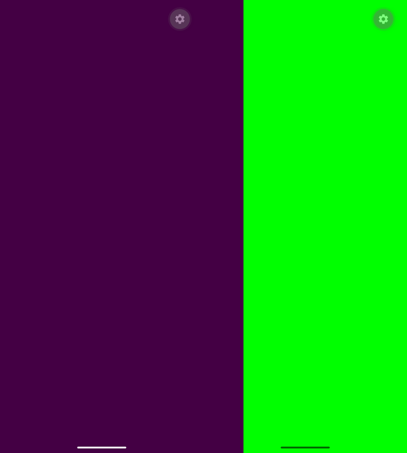

# Android front drawer reproduction

## Run

1. Start an Android emulator and install Expo Go for SDK 55.
2. Run `npm ci`, then `npm start`.
3. Press `a` to open the app on Android.
4. Tap **Open drawer** and wait for the animation to finish.

The green right-hand drawer should appear over the purple backdrop. On the Pixel 8 Pro emulator (Android 16, API 36, New Architecture), the backdrop appears and the green drawer stays hidden.

The app uses the published `react-native-drawer-layout@4.2.12` directly. Exact package versions are in `package.json`.

## Captures

Left shows unmodified `4.2.12`. Right shows the same fixture with only the Android front drawer's `zIndex` set to `2` in the package. The app in this repository runs the unmodified version.

Codex prepared the reproduction app and assisted with the emulator verification.
